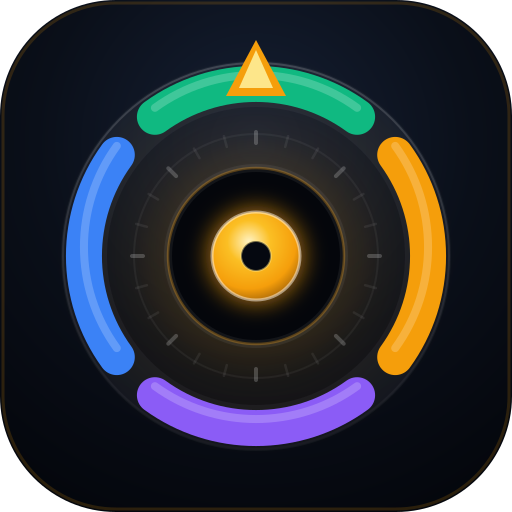

# 🎮 LOADOUT · لوداوت
### Game Approach OS — اکوسیستم شخصی اپروچ

> **لوداوت (Loadout)** = ستِ تجهیزاتی که قبل از هر مچ می‌بندی. تو هم یک لوداوت داری:
> اسکریپت، دریل، اسکیل، ونو، استایل، لاجستیک.
> **یک لوداوت، چهار آرنا:** آنلاین · گیم روز · سوشال سرکل · نایت گیم.

یک قیف، یک مغز، یک دیتابیس — با سینک ابری روی گیت‌هاب، رمزنگاری AES-256 و نصب به‌عنوان اپ بومی (PWA).

> نسخه‌های اولیه فقط «اینستاگرام» بودند. چهارسو همان موتور را به‌عنوان **یک جهت از چهار جهت** نگه می‌دارد و میدان واقعی (خیابان / دورهمی / شب) را با همان جدیت وارد سیستم می‌کند.

---

## 🧠 معماری چهارسو

| کانال | جای اجرا | تارگت پیش‌فرض | قیف اختصاصی |
|---|---|---|---|
| 📲 آنلاین گیم | اینستاگرام (فالو/استوری/DM) | ۲۱ رپ در هفته (هر ۳ فالو = ۱ رپ) | اپنر → بنتر → کوالیفای → سید → کلوز |
| ☀️ گیم روز | خیابان، کافه، دانشگاه، پاساژ | ۶ اپروچ در هفته | اپروچ موقعیتی → قلاب → شماره → اینسنت‌دیت |
| 🕸️ سوشال سرکل | دوستانِ دوستان، ایونت، باشگاه | ۳ تماس گرم در هفته | معرفی → ارزش → دعوت امن → ارتقا |
| 🌙 نایت گیم | پارتی، تالار، کافه قلیون | ۲ شب در هفته | رِک → ورود به گروه → آیزولیشن → لاجستیک → بستن |

هر رکورد در **قیف واحد** ثبت می‌شود: `اپروچ → قلاب → شماره/آیدی → اینسنت‌دیت → دیت → بستن` (+ بلو‌اوت به‌عنوان هزینه یادگیری).

---

## 📱 تب‌های اپ

1. **🛰️ اکوسیستم (هاب)** — سطح و XP، استریک، ۴ کارت کانال، مأموریت‌های امروز، رادار تعادل ۲۱ روزه، قیف واحد، ۶ قانون غیرقابل‌مذاکره، پل‌های بین کانال.
2. **⚔️ میدان** — برای هر کانال: قوانین طلایی، اسکریپت‌های آماده (با کپی یک‌کلیکی)، دریل‌های روزانه، اسکیل‌تری و ونو والت (با امتیازدهی).
3. **🧲 قیف واحد** — همه کیس‌ها از همه کانال‌ها + فیلتر زنده/دیت/عقب‌افتاده + لیدربورد اپنرها و ونوها + هیت‌مپ زمان (روز × صبح/عصر/شب).
4. **⚡ میز نوبت** — موتور اینستاگرام: ۳+۳+۳ فالو روزانه، تایمر ضدِ بن ۴۵–۷۵ ثانیه، لغو ۶۴۵ معلق.
5. **💬 قیف چت** — کیس‌های DM و کمین استوری ۷ روزه.
6. **💎 رادار پیج** — ۸ کیس Mutual + وان‌وی‌ها + پارادوکس‌ها (`@sawanabdi` به‌عنوان پسر از تارگت‌ها حذف شد).
7. **🧹 پاک‌سازی** — ۳۱ سوخته + ۶۱ یک‌طرفه + وایت‌لیست ۷۰/۳۰.
8. **♟️ تاد وی و نقشه ۹۰ روز** — چک‌لیست ۱۲ مرحله‌ای.
9. **☁️ گیت‌هاب** — توکن، Gist مخفی، ریپوی Private، رمزنگاری، بکاپ JSON.

---

## 🎮 سیستم پیشرفت

- **XP**: اپروچ ۱۰ • قلاب ۱۵ • شماره ۲۵ • اینسنت‌دیت ۳۵ • دیت ۶۰ • بستن ۱۲۰ • بلو‌اوت ۶ (بله، بلو‌اوت هم XP دارد؛ داده است).
- **۱۰ سطح**: از «تازه‌وارد» تا «افسانه سنندج» (۸۰۰۰ XP).
- **اسکیل‌تری ۲۳ نودی**: هر اسکیل با هر رکورد +۱ رپ؛ ۲۵ رپ = استاد.
- **مأموریت روزانه**: خودکار بر اساس روز هفته و شکاف کانال‌ها (شب فقط پنجشنبه/جمعه، رِک چهارشنبه).
- **استریک**: هر روزی که یا اپروچ ثبت شود یا فالو انجام شود.
- **رادار تعادل**: اگر یک کانال ۳ هفته صفر بماند، هاب با CTA «پمپش کنیم» هشدار می‌دهد.

---

## 🚀 راه‌اندازی آنلاین (۲ دقیقه)

**روش پیشنهادی: GitHub Pages — آپلود با توکن، بدون Git.**

1. توکن بساز: [github.com/settings/tokens/new?scopes=repo](https://github.com/settings/tokens/new?scopes=repo)
   (Classic token · فقط تیک `repo` · مدت ۹۰ روز)
2. فایل `LOADOUT_Deployer.html` را باز کن، توکن و نام ریپو را بزن، دکمه‌ی آپلود.
3. آدرس سایت: `https://<username>.github.io/<repo>/`

روش دستی (بدون توکن)

- یک ریپوی **Public** بساز → دکمه‌ی `Add file → Upload files` → محتویات این پوشه را بکش و رها کن.
- `Settings → Pages → Source = Deploy from a branch → main → / (root)` → Save.

### ⚠️ توجه به حریم خصوصی
با Pages، کد اپ **عمومی** می‌شود؛ یعنی متن اسکریپت‌ها و پلی‌بوک‌ها قابل خواندن است.
**داده‌های تو** (کیس‌ها، لیدها، لاگ) هرگز داخل ریپو نمی‌رود — در `localStorage` مرورگر + Gist مخفی می‌ماند.
اگر می‌خواهی کد هم خصوصی باشد: ریپوی **Private** + Cloudflare Pages یا Vercel (رایگان).

### ☁️ سینک ابری دیتابیس
تب **☁️ گیت‌هاب** → یک توکن جدا با اسکوپ `gist` بساز → «ساخت دیتابیس مخفی» → رمز AES-256 بگذار.

### نصب روی گوشی (PWA)
لینک را در Chrome اندروید باز کن → منوی سه‌نقطه → **Add to Home screen**. اپ آفلاین هم بالا می‌آید (`sw.js`).

---

## ☁️ اتصال دیتابیس ابری گیت‌هاب

1. `Settings → Developer settings → Personal access tokens → Tokens (classic)` → توکن با تیک **`gist`**.
2. در تب **☁️ گیت‌هاب** توکن را بگذار؛ اختیاری یک رمز عبور برای `PBKDF2 + AES-256-GCM` بگذار.
3. **«✨ ساخت خودکار دیتابیس مخفی Gist»** → روی دستگاه دوم **«🔍 پیدا کردن خودکار Gist»**.
4. یا حالت **Private Repo**: `owner/repo` + مسیر `data/yaser_eco_vault.json` (با مدیریت SHA و تلاش مجدد روی ۴۰۹).

کل داده (شامل لاگ میدان، اسکیل‌ها، ونوها و تنظیمات) در یک JSON ذخیره می‌شود؛ توکن و رمز فقط در `localStorage` همان مرورگر می‌مانند.

---

## 💾 بکاپ

تب **☁️ گیت‌هاب** → **⬇️ Export JSON** برای بکاپ کامل و **⬆️ Import JSON** برای بازگردانی.
داده نسخه‌های قبلی (`yaser_ig_command_v6` و `yaser_ig_tracker_v4`) به‌صورت خودکار مهاجرت می‌کند.

---

## 🔒 حریم خصوصی

- هیچ سرور واسطی وجود ندارد؛ ارتباط مستقیم مرورگر ↔ `api.github.com`.
- با رمز AES، حتی گیت‌هاب هم محتوای دیتابیس را نمی‌بیند.
- `@yaserbarzanji` پروفایل، ۶ پست و ۷ هایلایت **قفل** است و در اپ هیچ پیشنهاد تغییری برایشان وجود ندارد.

---

## 🎮 هویت برند

- **نام:** LOADOUT (لوداوت) — «ست تجهیزات آماده‌ی نبرد»؛ اصطلاح پایه‌ای هر گیمر.
- **شعار:** یک لوداوت، چهار آرنا.
- **لوگو:** **چرخ لوداوت (Weapon Wheel)** — ۴ اسلات رنگی روی چرخ + سلکتور طلایی روی اسلات فعال + هسته طلایی (خودِ تو) + حلقه HUD تیک‌دار.
  - 🟢 سبز = آنلاین · 🟡 طلایی = گیم روز · 🟣 بنفش = سوشال سرکل · 🔵 آبی = نایت گیم
- **فایل‌ها:** `assets/loadout-icon.svg` · `loadout-512.png` · `loadout-192.png` · `loadout-maskable-512.png` · `apple-touch-icon.png`

ساخته‌شده برای **یاسر برزنجی** • سنندج • ۲۰۲۶
